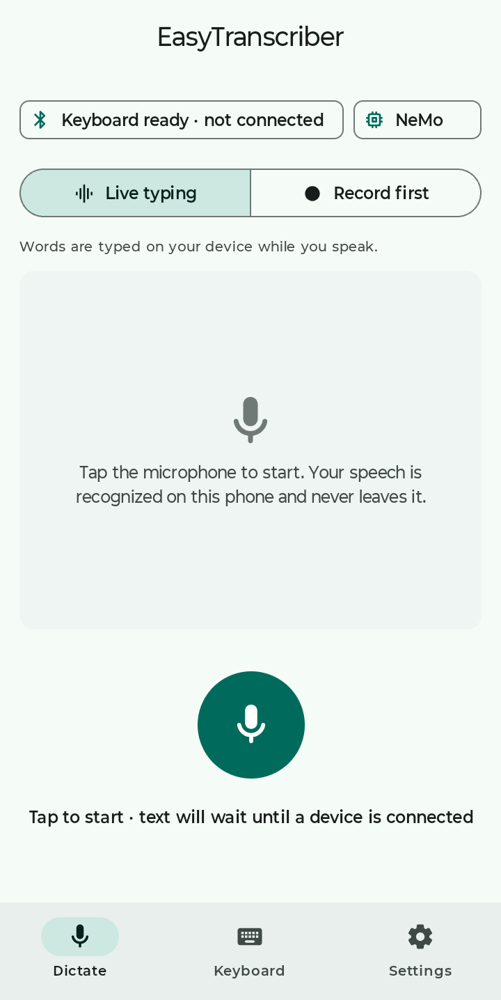
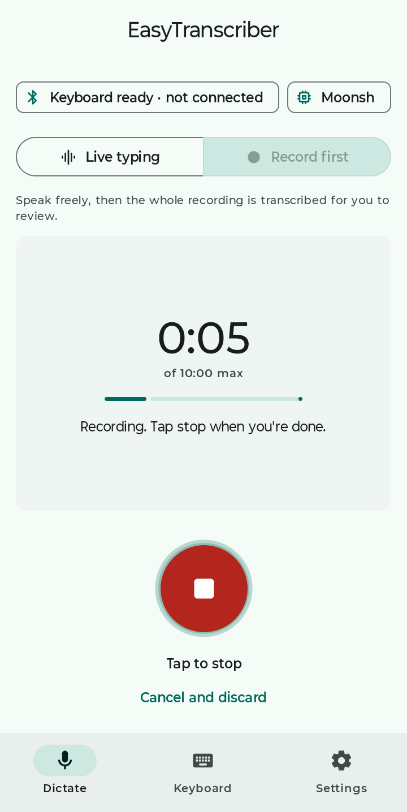
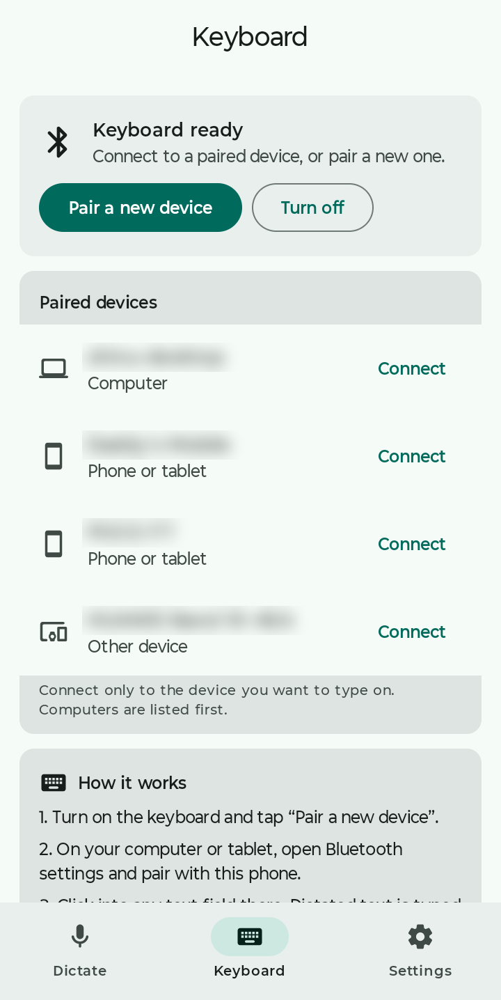
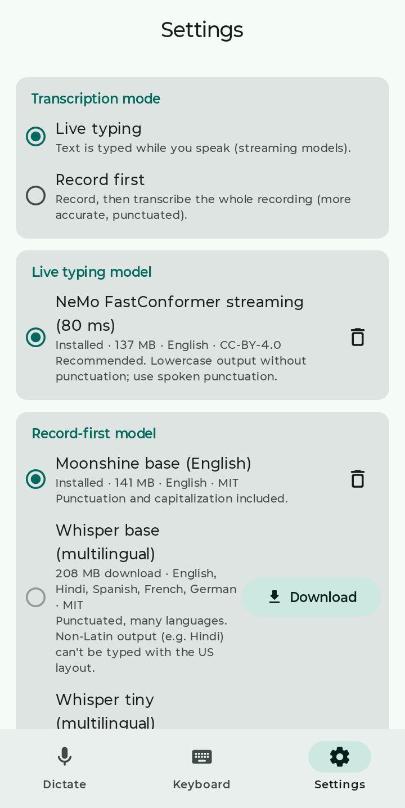
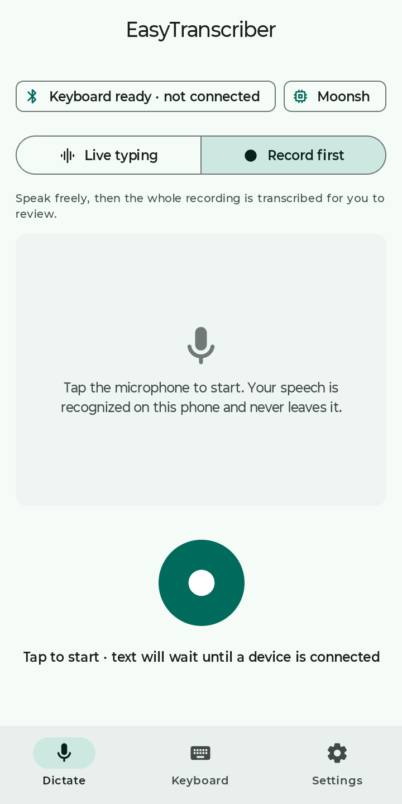
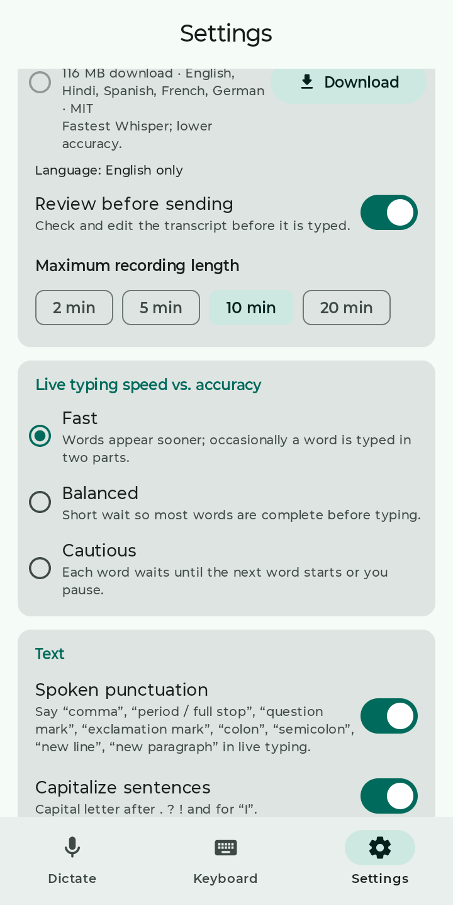
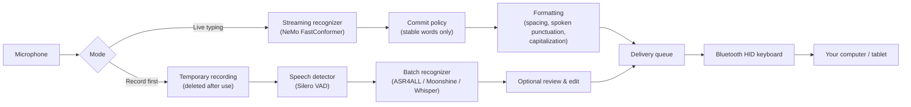

# EasyTranscriber

### tl;dr if you don't care about LLM-sloppa

Its an application that lets you speak into your phone, your phone runs a speech-to-text model locally, and poses as a Bluetooth keyboard, inputting the transcribed text to whatever device is connected on the other end. Can be a PC, phone, tablet, smart TV, whatever you want.

I made this because I wanted a fast, offline, speech-to-text device that could be portable and handy, plus device agnostic. I previously thought of having a RPi 5, but it would've gotten too big. A smartphone is an okay compromoise I suppose.

You will need your phone to have the BLE HID profile enabled. I use a Motorola G45 smartphone for this, the BLE HID profile can be enabled in the developer settings.

**Turn your Android phone into an offline, voice-powered Bluetooth keyboard.**

[](LICENSE)


Speak into your phone and the words are typed on your computer, tablet or any other device that accepts a
Bluetooth keyboard. Speech recognition runs entirely on the phone: no cloud service, no account, and no
software to install on the receiving device.

<p align="center">
  
  
  
  
</p>

---

## Contents
- [Features](#features)
- [How it works](#how-it-works)
- [Requirements](#requirements)
- [Getting started](#getting-started)
- [Using the app](#using-the-app)
- [Privacy](#privacy)
- [Performance](#performance)
- [Limitations](#limitations)
- [Building from source](#building-from-source)
- [Project structure](#project-structure)
- [Troubleshooting](#troubleshooting)
- [Technology](#technology)
- [Licenses and credits](#licenses-and-credits)

## Features
- **Works as a real Bluetooth keyboard.** Pair the phone with a computer or tablet and dictated text is typed into whatever text field is focused. The receiving device needs no app or driver.
- **Two dictation modes:**
  - **Live typing:** words appear on the other device *while you are still speaking*.
  - **Record first:** speak freely, then the whole recording is transcribed with punctuation and capitalization. Recording ends by itself when you pause (or tap stop, if you prefer), and you can review and edit the text before it is sent.
- **Fully offline recognition.** Models are downloaded once inside the app; after that no internet connection is needed.
- **Choice of speech models**, each listed with its size, languages and license.
- **Spoken punctuation** in live typing ("comma", "period", "new line", …) and automatic sentence capitalization.
- **Safe delivery:**
  - Text that's already been typed is never silently changed.
  - If the Bluetooth connection drops, the app shows which characters may not have arrived and lets you resend or skip them; it never retypes anything on its own.
  - Characters the keyboard layout can't type are flagged instead of being replaced with something wrong.
- **Works in the background** with a notification and a Stop button, so you can keep dictating while using other apps.
- **Settings are remembered** across restarts.

<p align="center">
  
  
</p>

## How it works



1. **Recognition:**
   - **Live typing** feeds the microphone to a *streaming* model in 50 ms chunks. The model keeps its state between chunks, so words are recognized as you speak; nothing waits for the end of the sentence.
   - **Record first** saves audio to a temporary file. While you speak, a speech detector listens for a pause (2 s by default, adjustable or off in Settings) and then ends the recording. The detector also splits the recording at pauses, and each piece is transcribed by a model that sees the whole utterance, which gives better punctuation and accuracy. The recording is deleted as soon as transcription finishes, fails or is cancelled.
2. **Commit policy (live typing):** a recognizer may still revise the word you're saying, so a word is only sent once it's stable: either the next word has started or it hasn't changed for a short moment. If the recognizer later extends a word ("un" → "unbelievable"), only the missing letters are typed.
3. **Keyboard output:** Android's Bluetooth HID Device API (`BluetoothHidDevice`) makes the phone appear as a standard keyboard. Text is converted to US-QWERTY key presses and typed in order. Both modes share the same delivery queue.

## Requirements
**Phone**
- Android 9 (API 28) or newer. The Bluetooth HID Device API doesn't exist before Android 9.
- The manufacturer must not have disabled the Bluetooth **HID Device** role. Most phones have it enabled.
  - **Motorola:** it's off by default. Enable it in *Developer options*, then turn Bluetooth off and on again.
  - If the role is unavailable, the app tells you; it won't fail silently.
- About 150–500 MB of free storage for models, and an internet connection for the one-time model download.

**Receiving device**
- Anything that accepts a Bluetooth keyboard: Windows, macOS, Linux, ChromeOS, Android, iPadOS.
- Its keyboard layout must be set to **English (US)**.
- Tested so far with Linux (BlueZ 5.72); other operating systems should work but haven't been tested yet.

## Getting started
1. **Install** the APK on your phone (see [Building from source](#building-from-source), or a release download).
2. **Download a model.** On first launch the Dictate tab offers the recommended model. Tap **Download** and keep the app open until it finishes. More models are in **Settings → Models**.
3. **Pair with your computer:**
   - Open the **Keyboard** tab and tap **Pair a new device**.
   - On the computer, open its Bluetooth settings and pair with your phone.
   - Back in the app, tap **Connect** next to the computer.
4. **Dictate.** Click into a text field on the computer, open the **Dictate** tab and tap the microphone.

## Using the app

| Tab | What it's for |
|---|---|
| **Dictate** | Choose *Live typing* or *Record first* and tap the microphone to start or stop. Shows the transcript, delivery progress and any connection problems. |
| **Keyboard** | Turn the Bluetooth keyboard on or off, pair a new device, connect to a paired one, and send a test line. |
| **Settings** | **Models** (download, choose or delete models for each mode; language for Whisper), whether *Record first* stops by itself after a pause, review before sending, live-typing speed vs. accuracy, spoken punctuation, capitalization and typing speed. |

### Spoken punctuation (Live typing)
| Say | Types |
|---|---|
| "comma" | `,` |
| "period" / "full stop" | `.` |
| "question mark" | `?` |
| "exclamation mark" / "exclamation point" | `!` |
| "colon" / "semicolon" | `:` / `;` |
| "new line" | line break |
| "new paragraph" | two line breaks |

Spoken punctuation can be turned off in Settings. *Record first* models punctuate automatically.

### Live typing speed vs. accuracy
| Setting | Behavior |
|---|---|
| **Fast** (default) | A word is typed once it has been stable for 120 ms. Lowest latency; occasionally a word is typed in two parts, and the result is still correct. |
| **Balanced** | 300 ms wait; most words are complete before they're typed. |
| **Cautious** | Each word waits until the next word starts or you pause. |

### If the connection drops
Bluetooth can report a key as sent even if the other device never received it. After a disconnect the
app shows the characters that *may not have arrived* and waits for you:
- **Resend them** retypes those characters. Use this if they're missing on your device.
- **Skip them** continues without them. Use this if they did arrive.
- **Clear all** discards everything that hasn't been typed.

Text is never retyped automatically, so you won't get unexpected duplicates.

## Privacy
- Speech is recognized **only on the phone**. Audio and transcripts are never uploaded.
- The internet permission is used **only** to download the models you choose, from the
  [sherpa-onnx releases](https://github.com/k2-fsa/sherpa-onnx/releases) on GitHub or, for ASR4ALL,
  [FUTO's model pages](https://huggingface.co/futo-org) on Hugging Face (pinned revisions). Every downloaded file is checked against a pinned SHA-256 checksum before use.
- Recordings (*Record first*) are temporary and deleted as soon as transcription ends. Nothing is kept after a restart.
- No analytics, no tracking, no accounts.
- The only output is keystrokes sent to the device **you** connected.

## Performance
Measured on a **Motorola moto g45 5G** (Snapdragon 6s Gen 3 class, 8 GB RAM, Android 15) typing into a
Linux desktop. Your results will vary with the phone and the receiving device.

| Measurement | Result |
|---|---|
| Live typing: spoken word → visible on computer | about **0.5 s** typical (p50 500–523 ms, p90 ≈ 640 ms) |
| Live typing: recognizer word latency | ≈ 200 ms (p50) |
| Typing speed over Bluetooth | ≈ 10–16 ms per character |
| Record first: 26 s of speech transcribed in | 3.3 s (Moonshine base), 4.6 s (Whisper tiny), 8.7 s (Whisper base) |
| Live model memory / CPU | ≈ 315 MB, about one CPU core |
| Continuous recognition | 10 minutes with flat memory and no dropped audio |

Detailed measurements and methods are in the [engineering reports](#engineering-reports).

## Limitations
- **Keyboard layout:** output uses the **English (US)** layout only. Accented letters (é, ñ), other symbols (—, “ ”) and non-Latin scripts can't be typed through a standard Bluetooth keyboard this way; the app shows them and asks what to do.
- **Languages:**
  - Live typing is **English only**.
  - Whisper models (Record first) recognize other languages, including Hindi. Text in non-Latin scripts can be read and edited in review but can't be typed with the US layout.
- **No automatic punctuation in live typing.** Use spoken punctuation, or *Record first* for punctuated text.
- **Proper nouns:** names aren't capitalized automatically in live typing.
- **Model downloads** need a connection and about 100–375 MB each; recognition itself is offline.
- **Phone compatibility:** some manufacturers disable the Bluetooth HID Device role (see [Requirements](#requirements)).

## Building from source
**Requirements:** JDK 17+, Android SDK with platform 35, and `local.properties` containing `sdk.dir=/path/to/Android/Sdk`.

```sh
scripts/fetch-deps.sh         # downloads the prebuilt sherpa-onnx AAR (checksum-verified)
./gradlew testDebugUnitTest   # unit tests
./gradlew assembleDebug       # debug build (includes developer tools)
./gradlew assembleRelease     # release build (signed, minified)
```

**Signing the release build:**
- It's signed with the key described in `keystore.properties` (`storeFile`, `storePassword`, `keyAlias`, `keyPassword`).
- That file and the key itself are git-ignored and must never be committed.
- Keep a backup: app updates must be signed with the same key.

**Debug builds** add a *Diagnostics* tab for development:
- a streaming benchmark
- playback of recorded test sets through the full pipeline instead of the microphone
- an event log
- per-session measurement reports

Developer scripts:
- `scripts/install-models.sh` pushes models over USB.
- `tools/host_capture.py` and `scripts/e2e_latency.py` measure end-to-end latency on a Linux host.

## Project structure
```
app/src/main/java/com/easytranscriber/
├── audio/         microphone capture, WAV recording/reading
├── batch/         Record first: VAD segmentation and batch transcription
├── bluetooth/     Bluetooth HID Device registration and connection state
├── dictation/     session controller (state machine) and foreground service
├── hid/           HID report descriptor, US layout, key-press sender
├── models/        model download, extraction and checksum verification
├── output/        delivery queue shared by both modes
├── pipeline/      streaming pipeline (bounded queue, inference thread, metrics)
├── recognition/   engine interface, sherpa-onnx and ASR4ALL (ONNX Runtime) engines, model catalog
├── settings/      persisted settings (DataStore)
├── transcript/    commit policy and text formatting
└── ui/            Jetpack Compose screens
```
73 JVM unit tests cover key encoding, typing and failure accounting, text formatting, the commit
policy, the delivery queue (including disconnects), WAV handling, batch transcription, pause
detection, ASR4ALL output rendering and model installation. One ASR4ALL test runs a real model and
is skipped unless `ASR4ALL_DIR` and `ASR4ALL_WAVS` are set (see `Asr4AllEngineTest`).

## Troubleshooting
| Problem | What to do |
|---|---|
| "Keyboard couldn't start" | The phone's Bluetooth HID Device role is disabled. On Motorola, enable it in Developer options, then turn Bluetooth off and on. Close other apps that act as a Bluetooth keyboard or mouse. |
| Computer doesn't connect, or is stuck on "Connecting" | Connect from the phone (Keyboard tab → Connect). On Linux, mark the phone as trusted: `bluetoothctl trust <phone address>`. |
| Wrong characters appear | Set the computer's keyboard layout to English (US). |
| Characters are missing | Settings → Typing speed → **Careful**. |
| Words appear too slowly | Settings → Live typing speed → **Fast**. |
| A model download fails | Check the connection and tap **Retry**. Nothing is installed unless every file passes its checksum. |
| Text is waiting and nothing is typed | After a reconnect the app waits for you: tap **Continue**, **Resend** or **Skip** on the Dictate tab. |

## Technology
| Component | Used for |
|---|---|
| [Kotlin](https://kotlinlang.org/) and [Jetpack Compose](https://developer.android.com/jetpack/compose) (Material 3) | App and UI |
| Android `BluetoothHidDevice` API | Acting as a Bluetooth keyboard |
| [sherpa-onnx](https://github.com/k2-fsa/sherpa-onnx) 2.0.0 with [ONNX Runtime](https://onnxruntime.ai/) | On-device speech recognition and voice activity detection |
| ONNX Runtime Java API (`onnxruntime-android` 1.28) | Running ASR4ALL, which sherpa-onnx doesn't support |
| NVIDIA NeMo FastConformer (streaming, 80 ms and 480 ms) | Live typing models |
| ASR4ALL small/medium/large (English), Moonshine base (English), OpenAI Whisper tiny/base | Record first models |
| Silero VAD | Splitting recordings at pauses |
| Jetpack DataStore | Settings |
| Apache Commons Compress | Extracting downloaded model archives |
| Kotlin coroutines | Audio, inference and Bluetooth threading |

## Licenses and credits
**Project license:** EasyTranscriber's own source code is released under the [MIT License](LICENSE).
Third-party libraries and speech models keep their own licenses, listed below and in
[THIRD_PARTY_NOTICES.md](THIRD_PARTY_NOTICES.md). Include that file when you distribute the app.

**Third-party software bundled in the app**
| Software | License |
|---|---|
| sherpa-onnx | Apache-2.0 |
| ONNX Runtime (shared by sherpa-onnx and the ONNX Runtime Java API) | MIT |
| AndroidX, Jetpack Compose, Material icons | Apache-2.0 |
| Kotlin standard library, kotlinx.coroutines | Apache-2.0 |
| Apache Commons Compress | Apache-2.0 |

**Speech models** (downloaded by the user at runtime, not included in the app)
| Model | Author | License |
|---|---|---|
| NeMo FastConformer streaming transducer, 80 ms and 480 ms (`stt_en_fastconformer_hybrid_large_streaming_multi`), int8 ONNX conversion by sherpa-onnx | NVIDIA | [CC-BY-4.0](https://creativecommons.org/licenses/by/4.0/) |
| ASR4ALL small / medium / large, English (ONNX release) | FUTO | [FUTO Model Weights License 1.0](https://huggingface.co/futo-org/asr4all-s/blob/main/LICENSE) (restricted use; dictation and personal use permitted) |
| Moonshine base, English | Moonshine AI (Useful Sensors) | MIT (English models) |
| Whisper tiny / base, int8 ONNX conversion by sherpa-onnx | OpenAI | MIT |
| Silero VAD | Silero Team | MIT |

See [THIRD_PARTY_NOTICES.md](THIRD_PARTY_NOTICES.md) for full attributions and license links.

## Engineering reports
- [Feasibility study](docs/FEASIBILITY.md): platform research, engine selection and risks
- [Bluetooth keyboard hardware test](docs/HID_TEST_REPORT.md)
- [Streaming recognition measurements](docs/STAGE3_STREAMING_REPORT.md)
- [Integration report](docs/INTEGRATION_REPORT.md): end-to-end latency, reliability tests and acceptance criteria
